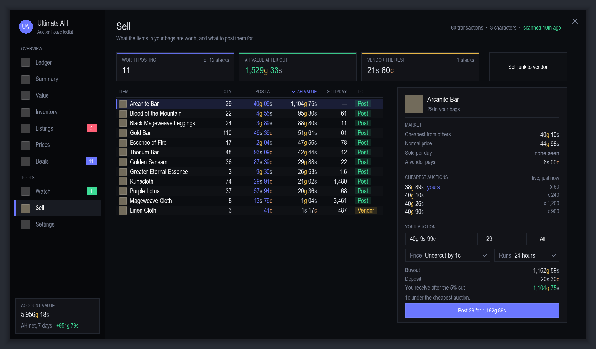

# Ultimate AH

An auction house toolkit for **World of Warcraft: Forever** (interface 16001): a ledger of every
buy and sale across your characters, price scans, a value graph, a deal finder, a watchlist,
posting from your bags, and hourly price scans through Blizzard's web API, including an estimate
of how many units of each item sell per day.



The screenshots in `renders/` are drawn outside the game by `render_ui.py` from the addon's real
layout code with sample data. Fonts and icons differ a little from the game.

## Status

- The ledger, scans, value graph, deal finder and guild price replies (1.x) were built and
  checked in the game.
- The 2.x work has only been tested outside the game so far: the new look, the Watch, Sell and
  Settings pages, posting auctions from the Sell page, and loading API scan data. It is covered
  by 139 automated checks against a mocked game API and by the offline renders, but it has not
  been run in the live client yet. Treat 2.x as a beta.
- The API scan script has been run against Blizzard's real API (EU, Alliance).

## What is in here

| Path | What it is |
|---|---|
| `UltimateAH/` | The addon. Copy this folder into `_forever_\Interface\AddOns`. Its [README](UltimateAH/README.md) describes every page and command. |
| `ah_api.py` | Auto scans: downloads your auction house from Blizzard's Game Data API every hour and writes `ApiData.lua` for the addon. |
| `deploy.py` | Copies `UltimateAH/` into the game folder. |
| `sync_accounts.py` | Merges the addon's saved data across WoW accounts on one PC. |
| `test_*.py`, `tests_v2.py` | Tests: the addon's Lua runs in [lupa](https://pypi.org/project/lupa/) against a mocked WoW API. |
| `render_ui.py` | Draws every page to a PNG without the game. |
| `luacheck.py`, `uipass.py` | Syntax check and a search/replace helper. |

## Install the addon

1. Copy the `UltimateAH` folder into `World of Warcraft\_forever_\Interface\AddOns`
   (or run `python deploy.py`).
2. Start the game, then `/uah` or the minimap button.

## Auto scans through Blizzard's API (optional)

An addon cannot reach the internet, so a small Python script does it from outside the game.

1. Create an API client at https://develop.battle.net/access/clients.
2. Copy `blizzard_api.example.json` to `blizzard_api.json` and fill in the client ID and secret.
   That file is ignored by git: never commit it.
3. `python ah_api.py check` tests the keys. `python ah_api.py detect` finds which auction house is
   yours by comparing prices with your last in-game Full Scan (do one first, then `/reload`).
4. `python ah_api.py auto` runs a scan. Schedule it hourly, for example with Windows Task Scheduler.
5. The addon loads the data at login or `/reload`. `/uah api` shows what it loaded.

Needs Python 3.10+ and `pip install lupa` (used to read the addon's saved data).

Blizzard has not documented the Forever API. The script uses what the community found by probing:
namespace `dynamic-forever-<region>`, auctions under `/data/wow/ruleset/<id>/auctions/<house>`.
It may break when Blizzard changes things.

### Units sold per day

Each hourly scan is compared with the one before. An auction that vanished counts as sold when it
still had more time left than passed between the scans and no cheaper auction of the same item
stayed behind. A commodity listing whose quantity dropped counts as partly bought. Cancelled
auctions cannot be told apart perfectly, so read the number as an estimate.

## Development

```
pip install lupa pillow
python luacheck.py
python test_tracker.py
python test_ui.py
python test_api.py
python test_sell.py
python render_ui.py renders
```

Edit the addon in `UltimateAH/`, run the tests, then `python deploy.py` to try it in the game.

Two things worth knowing:

- The game runs Lua 5.1, which refuses a file with more than 262,143 different constants. That
  is why `ApiData.lua` stores each item as one string and price history keeps three significant
  digits.
- The game only accepts posting, buying and cancelling from a real click, so nothing here
  automates trading: every auction is one click.
